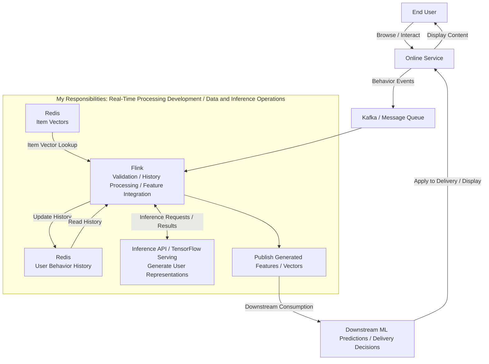
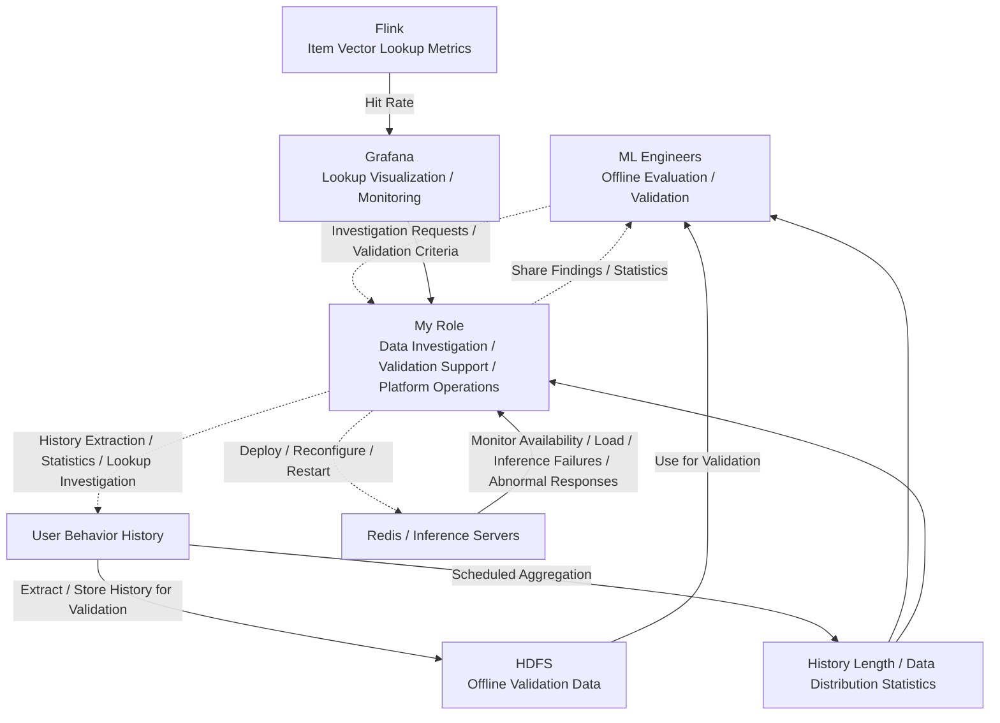

# リアルタイムデータ基盤 — 職務実績ポートフォリオ

[English](README.md) | [日本語](README.ja.md) | [简体中文](README.zh-CN.md)

図のラベルは、すべての言語版で英語に統一しています。

大規模インターネットサービスにおいて、ユーザー行動を機械学習による予測・配信判断へつなぐリアルタイムデータ基盤の開発・運用に携わっています。Java / Apache Flink によるストリーミング処理、Python / Apache Airflow によるデータパイプラインに加え、ML 担当者のオフライン検証を支えるデータ調査と、Redis・推論サーバーの運用を担当しています。

> 本資料は公開用です。守秘義務を遵守するため、会社名、サービス名、内部システム名、データ定義、構成値、性能値、障害情報などは記載せず、業務内容を一般化しています。

## 職務概要

| 項目 | 内容 |
| --- | --- |
| 参画期間 | 2025年1月〜現在 |
| 職種 | データエンジニア / バックエンドエンジニア |
| 担当工程 | 設計、実装、単体テスト、ステージング検証、リリース、運用改善、障害調査 |
| 主な領域 | リアルタイムストリーム処理、特徴量・推論連携、ML 検証向けデータ調査、データ品質監視、Redis・推論サーバー運用 |

## プロジェクト 1：リアルタイムデータ収集・エンリッチ基盤

複数サービスから発生するユーザー行動データをリアルタイムに処理し、後続の分析・推薦処理で利用できる形式へ変換する基盤の開発・運用を担当しました。

- Apache Flink によるイベントのデコード、検証、フィルタリング、変換、マスターデータ付与、出力処理を実装
- 検索・コマースなど複数ドメインのイベントスキーマ変更、新規属性追加、欠損値処理、センシティブカテゴリ除外に対応
- Redis を利用した参照データの取得、キー設計、TTL 制御、再接続処理、非同期アクセスを改善
- Apache Airflow によるマスターデータ連携 DAG の追加、リトライ／センサー設計、データソース移行、基盤バージョンアップに対応
- Spark / SQL / Iceberg を利用したデータ変換・検証処理を整備
- Kubernetes マニフェスト、環境別設定、シークレット参照、メッセージトピック、CI/CD ワークフローを整備
- Python / MCP による読み取り専用の検証ツールを作成し、クエリエンジン、Redis、メッセージキューを横断する確認作業を効率化
- モックを用いた単体テストを追加し、スキーマ境界、null、空配列、異常値などのケースを検証

## プロジェクト 2：パーソナライズを支えるリアルタイム特徴量・推論連携基盤

ユーザーの直近の行動をオンラインサービスの予測・配信判断へ反映するため、行動履歴とアイテム特徴量を統合し、オンライン推論 API を通じてユーザーの興味・関心を表すベクトルを生成・供給するパイプラインを、PoC から継続して開発しています。生成した特徴量・ベクトルは後段の予測モデルで利用され、エンドユーザーへの配信・表示の判断材料となります。

リアルタイム処理の開発に加え、ML 担当者からの調査依頼に応じた検証用データの提供、履歴データの定期的な統計集計、特徴量参照の監視、Redis と推論サーバーの運用まで担当しています。

### リアルタイム処理・推論連携

- Kafka / メッセージキューから受信したイベントを Flink でデコードし、event time、watermark、重複排除、履歴マージ、ウィンドウ集約を実装
- 履歴収集、前処理、特徴量参照、推論リクエスト、結果配信を独立した処理段階として設計・実装
- Redis からの履歴・特徴量取得を同期処理から非同期処理へ移行し、接続共有、再接続、トポロジー更新、バッチ取得を改善
- オンライン推論 API に対する非同期 HTTP / gRPC クライアント、認証更新、リトライ、タイムアウト、gzip 圧縮を実装
- バッチ化、パーティション分散、データスキュー対策、オブジェクト生成削減、I/O の並列化により処理効率と安定性を改善
- 遅延イベント、欠損 ID、同一時刻イベント、履歴上限、サービス別フィルタなどの境界条件を単体テストで検証
- 個人識別子のマスキング、ログのサンプリング／レート制御、メトリクス、環境別の出力制御を整備
- Flink のメジャーバージョン更新、コードフォーマット／静的チェック、環境別設定の一元化に対応

### ML 担当者との検証・調査連携

- ML 担当者がオフライン検証で確認したい観点に応じ、リアルタイムの行動履歴やアイテムベクトルの参照状況を調査
- 検証対象のユーザー行動履歴を HDFS へ抽出・保存し、ML 担当者のオフライン検証用データとして提供
- ユーザー行動履歴の長さやデータ分布を定期的に集計し、データの概要と変化を把握できるようにする
- 調査結果・統計情報を共有し、ML 側の検証とリアルタイムデータ側の確認を継続的に連携

### データ品質監視・基盤運用

- Flink アプリケーションにアイテムベクトル参照のヒット率メトリクスを実装し、Grafana と連携して参照状況を可視化・監視
- ヒット率を参照の成否を示す指標として扱い、ベクトルの内容の妥当性やモデルの予測品質とは区別して確認
- ユーザー行動履歴用 Redis、アイテムベクトル用 Redis、TensorFlow Serving による推論サーバーのデプロイ、設定変更、再起動、監視を担当
- 基盤の負荷、推論失敗、異常な応答内容を監視し、データ参照・推論 API・実行基盤を横断して調査

## 代表的なアーキテクチャ

以下は、実務上の役割と連携を公開用に抽象化した図です。内部システム名、具体的な接続構成、データ定義、モデル仕様、運用値は省略しています。

### オンライン：ユーザー行動から予測・配信判断への連携

ユーザー操作で生じる行動データを継続的に特徴量へ反映し、後段の予測システムが利用できる状態にします。行動に応じた非同期の特徴量更新と、生成済みの特徴量を利用するサービス側の処理を、役割単位で示しています。

担当領域には、推論 API の呼び出しと推論サーバーの運用を含みます。後段の予測モデルによる判断とサービス上の表示は、データの利用先として示しています。

### オフライン：ML 検証・データ調査・監視の連携

ML 担当者のオフライン検証と並行して、依頼されたデータ調査、検証用履歴の提供、定期統計、メトリクスによる参照状況の確認を行います。実線はデータ・監視情報、点線は調査依頼・結果共有・運用作業を表します。

### 役割と確認する内容

| 領域 | 自身の担当 | 利用・確認の目的 |
| --- | --- | --- |
| リアルタイムデータ供給 | 行動履歴の処理、アイテム特徴量参照、推論連携、生成結果の配信 | 後段の予測・配信判断へ直近の行動を反映する |
| ML 検証支援 | 調査依頼への対応、HDFS への検証用履歴提供、履歴長・分布の定期集計 | ML 担当者が入力データの実態を把握し、オフライン検証に利用する |
| ベクトル参照の監視 | Flink メトリクスの実装、Grafana によるヒット率の監視 | 必要なアイテムベクトルを参照できているか確認する |
| データ・推論基盤の運用 | Redis・TensorFlow Serving のデプロイ、設定、再起動、監視 | データ参照と推論を継続して提供し、負荷・失敗・異常応答を把握する |

## 技術スタック

| 分類 | 技術 |
| --- | --- |
| 言語 | Java, Python, SQL, Shell |
| ストリーム処理 | Apache Flink, Kafka, event time / watermark, 非同期 I/O, バッチ集約 |
| データ／ワークフロー | Redis, HDFS, Apache Airflow, Apache Spark, Trino, Apache Iceberg |
| ML 連携／推論基盤 | TensorFlow Serving, オンライン推論 API, オフライン検証向けデータ提供 |
| 通信／データ形式 | HTTP, gRPC, Protocol Buffers, Avro, JSON, gzip |
| インフラ／デリバリー | Kubernetes, Docker, Maven, CI/CD, 環境別構成管理 |
| 開発／検証ツール | MCP, Jupyter Notebook, 読み取り専用の運用診断ツール |
| 品質／運用 | JUnit, Mockito, 静的チェック, Grafana, Flink メトリクス, 構造化ログ, ログマスキング |

## 業務で重視していること

- **運用を前提とした実装**：正常系だけでなく、遅延、欠損、再接続、リトライ、バックプレッシャー、チェックポイントへの影響を考慮する
- **検証可能性**：メトリクスと安全なログを用意し、ステージング環境で設定差分とデータフローを確認できるようにする
- **データ保護**：ログへ生の識別子や入力データを出さず、必要最小限の情報だけで調査できるようにする
- **段階的な改善**：既存処理との互換性を保ちながら、非同期化、バッチ化、負荷分散、テスト拡充を進める

## 記載方針

本ポートフォリオは、本人が実際に変更を行った Git コミットと、本人が担当したデータ調査・検証支援・運用業務をもとに作成しています。成果を示す数値は、社外公開できる根拠がないため記載していません。また、公開リポジトリには業務コード、設定値、ログ、データ、社内文書を含めません。
