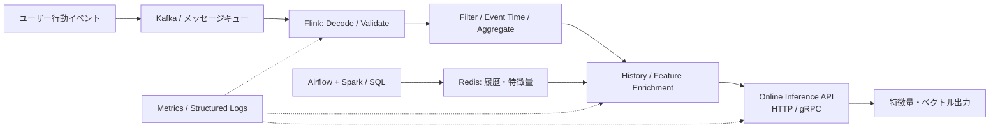

# リアルタイムデータ基盤 — 職務実績ポートフォリオ

大規模インターネットサービスにおいて、リアルタイムデータ処理、オンライン推論連携、バッチ／ワークフロー基盤の開発・運用に携わっています。主な担当は、Java / Apache Flink を中心としたストリーミングアプリケーションと、Python / Apache Airflow を中心としたデータパイプラインです。

> 本資料は公開用です。守秘義務を遵守するため、会社名、サービス名、内部システム名、データ定義、構成値、性能値、障害情報などは記載せず、業務内容を一般化しています。

## 職務概要

| 項目 | 内容 |
| --- | --- |
| 参画期間 | 2025年1月〜現在 |
| 職種 | データエンジニア / バックエンドエンジニア |
| 担当工程 | 設計、実装、単体テスト、ステージング検証、リリース、運用改善、障害調査 |
| 主な領域 | リアルタイムストリーム処理、データエンリッチ、オンライン推論連携、データパイプライン、運用自動化 |

## プロジェクト 1：リアルタイムデータ収集・エンリッチ基盤

複数サービスから発生するユーザー行動データをリアルタイムに処理し、後続の分析・推薦処理で利用できる形式へ変換する基盤の開発・運用を担当しました。

- Apache Flink によるイベントのデコード、検証、フィルタリング、変換、マスターデータ付与、出力処理を実装
- 検索・コマースなど複数ドメインのイベントスキーマ変更、新規属性追加、欠損値処理、センシティブカテゴリ除外に対応
- Redis を利用した参照データの取得、キー設計、TTL 制御、再接続処理、非同期アクセスを改善
- Apache Airflow によるマスターデータ連携 DAG の追加、リトライ／センサー設計、データソース移行、基盤バージョンアップに対応
- Spark / SQL / Iceberg を利用したデータ変換・検証処理を整備
- Kubernetes マニフェスト、環境別設定、シークレット参照、メッセージトピック、CI/CD ワークフローを整備
- Python / MCP による読み取り専用の検証ツールを作成し、クエリエンジン、Redis、メッセージキューを横断する確認作業を効率化
- モックを用いた単体テストを追加し、スキーマ境界、null、空配列、異常値などのケースを検証

## プロジェクト 2：リアルタイム特徴量生成・オンライン推論パイプライン

ユーザー行動履歴とアイテム特徴量をリアルタイムに統合し、オンライン推論 API と連携して後続システムへ特徴量・ベクトルを配信するストリーミングパイプラインを、PoC から継続して開発しています。

- Kafka / メッセージキューから受信したイベントを Flink でデコードし、event time、watermark、重複排除、履歴マージ、ウィンドウ集約を実装
- 履歴収集、前処理、特徴量参照、推論リクエスト、結果配信を独立した処理段階として設計・実装
- Redis からの履歴・特徴量取得を同期処理から非同期処理へ移行し、接続共有、再接続、トポロジー更新、バッチ取得を改善
- オンライン推論 API に対する非同期 HTTP / gRPC クライアント、認証更新、リトライ、タイムアウト、gzip 圧縮を実装
- バッチ化、パーティション分散、データスキュー対策、オブジェクト生成削減、I/O の並列化により処理効率と安定性を改善
- 遅延イベント、欠損 ID、同一時刻イベント、履歴上限、サービス別フィルタなどの境界条件を単体テストで検証
- 個人識別子のマスキング、ログのサンプリング／レート制御、メトリクス、環境別の出力制御を整備
- Flink のメジャーバージョン更新、コードフォーマット／静的チェック、環境別設定の一元化に対応

## 代表的なアーキテクチャ

以下は、担当領域を説明するために一般化した構成です。実際の社内構成やデータフローを示すものではありません。

## 技術スタック

| 分類 | 技術 |
| --- | --- |
| 言語 | Java, Python, SQL, Shell |
| ストリーム処理 | Apache Flink, Kafka, event time / watermark, 非同期 I/O, バッチ集約 |
| データ／ワークフロー | Redis, Apache Airflow, Apache Spark, Trino, Apache Iceberg |
| 通信／データ形式 | HTTP, gRPC, Protocol Buffers, Avro, JSON, gzip |
| インフラ／デリバリー | Kubernetes, Docker, Maven, CI/CD, 環境別構成管理 |
| 開発／検証ツール | MCP, Jupyter Notebook, 読み取り専用の運用診断ツール |
| 品質／運用 | JUnit, Mockito, 静的チェック, メトリクス, 構造化ログ, ログマスキング |

## 業務で重視していること

- **運用を前提とした実装**：正常系だけでなく、遅延、欠損、再接続、リトライ、バックプレッシャー、チェックポイントへの影響を考慮する
- **検証可能性**：メトリクスと安全なログを用意し、ステージング環境で設定差分とデータフローを確認できるようにする
- **データ保護**：ログへ生の識別子や入力データを出さず、必要最小限の情報だけで調査できるようにする
- **段階的な改善**：既存処理との互換性を保ちながら、非同期化、バッチ化、負荷分散、テスト拡充を進める

## 記載方針

本ポートフォリオは、本人が実際に変更を行った Git コミットの範囲をもとに作成しています。成果を示す数値は、社外公開できる根拠がないため記載していません。また、公開リポジトリには業務コード、設定値、ログ、データ、社内文書を含めません。
