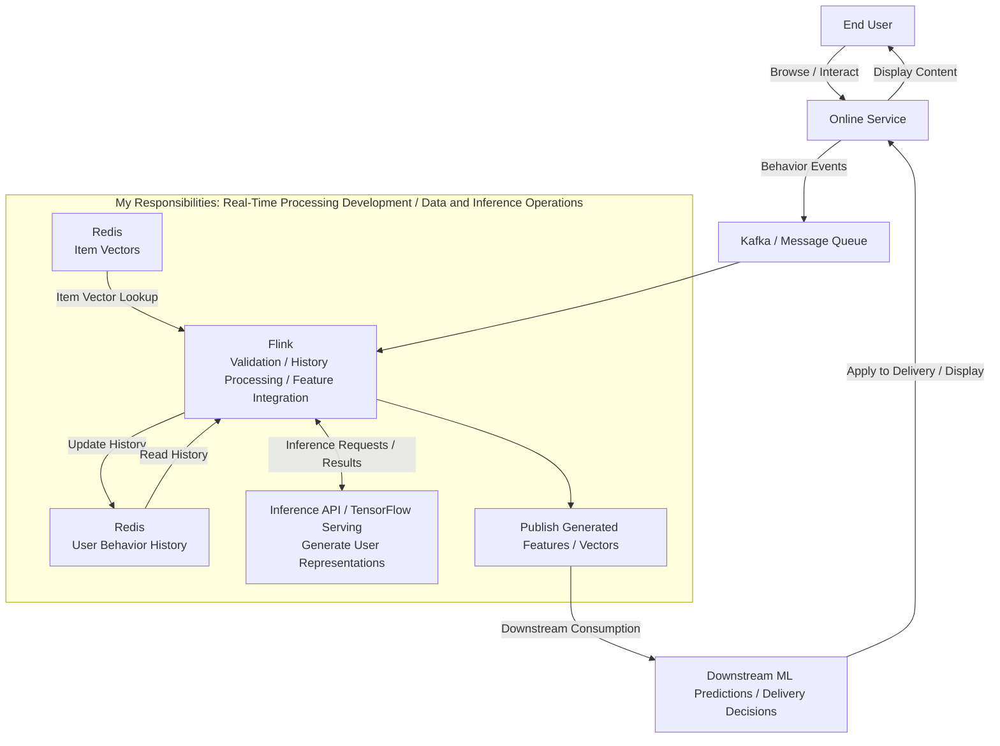
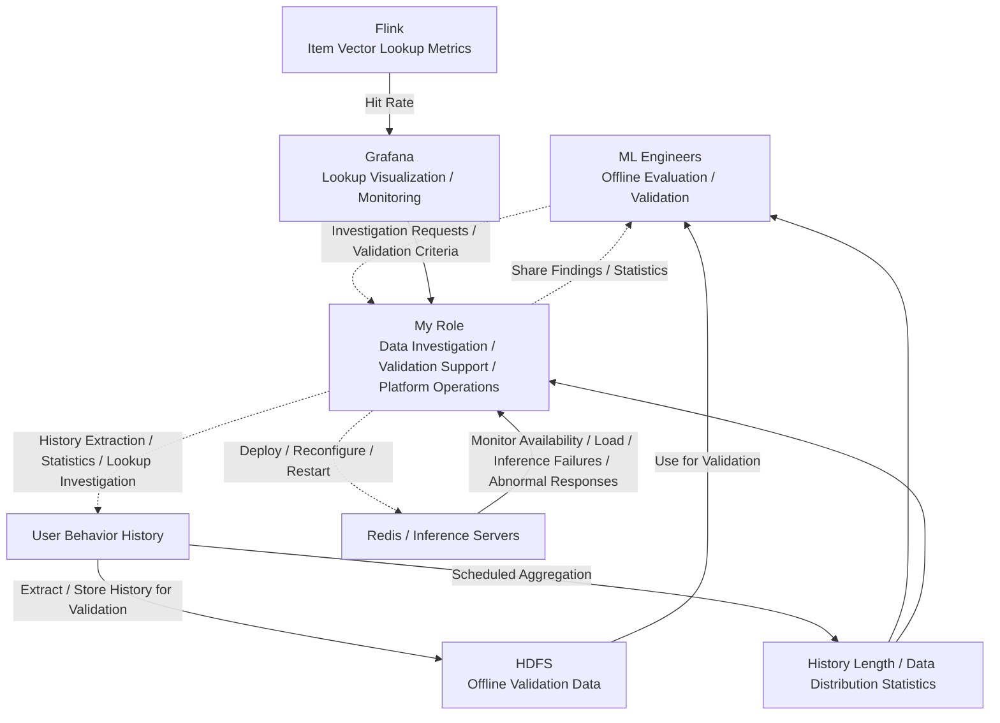

# Real-Time Data Platform — Professional Portfolio

[English](README.md) | [日本語](README.ja.md) | [简体中文](README.zh-CN.md)

Diagrams use English labels in all language versions.

I develop and operate real-time data platforms that connect user behavior to machine learning predictions and delivery decisions for large-scale internet services. My responsibilities include Java / Apache Flink stream processing, Python / Apache Airflow data pipelines, data investigations supporting offline ML validation, and Redis and inference server operations.

> This document is for public use. To respect confidentiality obligations, it generalizes the work and omits company names, service names, internal system names, data definitions, configuration values, performance figures, and incident details.

## Role Overview

| Item | Description |
|---|---|
| Period | January 2025–present |
| Role | Data Engineer / Backend Engineer |
| Responsibilities | Design, implementation, unit testing, staging validation, releases, operational improvements, and incident investigation |
| Main Areas | Real-time stream processing, feature and inference integration, data investigations for ML validation, data quality monitoring, and Redis / inference server operations |

## Project 1: Real-Time Data Collection and Enrichment Platform

I developed and operated a platform that processes user behavior data from multiple services in real time and transforms it for downstream analytics and recommendation processing.

- Implemented event decoding, validation, filtering, transformation, reference data enrichment, and output processing with Apache Flink.
- Handled event schema changes, new attributes, missing values, and sensitive category exclusions across domains such as search and commerce.
- Improved Redis reference data retrieval, key design, TTL management, reconnection, and asynchronous access.
- Added Apache Airflow DAGs for reference data integration, designed retries and sensors, and handled source migrations and platform upgrades.
- Built data transformation and validation processes using Spark / SQL / Iceberg.
- Maintained Kubernetes manifests, environment configuration, secret references, message topics, and CI/CD workflows.
- Created read-only validation tools with Python / MCP to streamline checks across query engines, Redis, and message queues.
- Added mocked unit tests covering schema boundaries, nulls, empty arrays, and invalid values.

## Project 2: Real-Time Feature and Inference Integration for Personalization

Since the proof-of-concept stage, I have continued developing a pipeline that combines behavior history and item features, then uses an online inference API to generate and supply vectors representing user interests. These features and vectors allow downstream prediction models to reflect recent behavior in online service delivery and display decisions.

Alongside real-time processing development, I provide validation data requested by ML engineers, regularly aggregate history statistics, monitor feature lookups, and operate Redis and inference servers.

### Real-Time Processing and Inference Integration

- Decoded Kafka / message queue events in Flink and implemented event time, watermarks, deduplication, history merging, and window aggregation.
- Designed and implemented history collection, preprocessing, feature lookup, inference requests, and result delivery as separate processing stages.
- Migrated Redis history and feature retrieval from synchronous to asynchronous processing, improving connection sharing, reconnection, topology refresh, and batch retrieval.
- Implemented asynchronous HTTP / gRPC clients for online inference APIs, authentication refresh, retries, timeouts, and gzip compression.
- Improved efficiency and stability through batching, partition distribution, data skew handling, reduced object allocation, and parallel I/O.
- Tested boundary conditions including late events, missing IDs, events with identical timestamps, history limits, and service-specific filters.
- Added identifier masking, log sampling and rate limits, metrics, and environment-specific output controls.
- Supported major Flink upgrades, code formatting and static checks, and centralized environment configuration.

### Collaboration with ML Engineers on Validation and Investigation

- Investigated real-time behavior history and item vector lookups based on the criteria ML engineers needed for offline validation.
- Extracted selected user behavior histories to HDFS and provided them as offline validation data.
- Regularly aggregated history lengths and data distributions to make the data characteristics and changes visible.
- Shared findings and statistics to coordinate ongoing checks across ML validation and real-time data processing.

### Data Quality Monitoring and Platform Operations

- Implemented Flink metrics for item vector lookup hit rates and integrated them with Grafana for visualization and monitoring.
- Used hit rates to measure lookup success, separately from vector content validity or model prediction quality.
- Handled deployment, configuration changes, restarts, and monitoring for behavior-history Redis, item-vector Redis, and TensorFlow Serving inference servers.
- Monitored platform load, inference failures, and abnormal responses, investigating across data lookups, inference APIs, and runtime infrastructure.

## Representative Architecture

The following diagrams abstract my responsibilities and system interactions for public presentation. Internal system names, specific connections, data definitions, model specifications, and operating values are omitted.

### Online: From User Behavior to Prediction and Delivery Decisions

Behavior data continuously updates features for downstream prediction systems. The diagram shows asynchronous feature updates triggered by behavior and service-side consumption of previously generated features, grouped by responsibility.

My responsibilities include calling inference APIs and operating inference servers. Downstream model decisions and service displays are shown as consumers of the data.

### Offline: ML Validation, Data Investigation, and Monitoring

In parallel with offline ML validation, I investigate requested data, provide histories for validation, produce periodic statistics, and check lookup status through metrics. Solid arrows represent data and monitoring information; dotted arrows represent investigation requests, shared findings, and operational actions.

### Responsibilities and Validation Goals

| Area | My Responsibilities | Purpose |
|---|---|---|
| Real-time data delivery | Process behavior history, look up item features, integrate inference, and publish generated results | Reflect recent behavior in downstream prediction and delivery decisions |
| ML validation support | Respond to investigation requests, provide history data through HDFS, and aggregate history lengths and distributions | Help ML engineers understand input data and use it for offline validation |
| Vector lookup monitoring | Implement Flink metrics and monitor hit rates in Grafana | Check whether required item vectors can be retrieved |
| Data and inference operations | Deploy, configure, restart, and monitor Redis and TensorFlow Serving | Maintain data lookup and inference availability and identify load, failures, and abnormal responses |

## Technology Stack

| Category | Technologies |
|---|---|
| Languages | Java, Python, SQL, Shell |
| Stream Processing | Apache Flink, Kafka, event time / watermarks, asynchronous I/O, batch aggregation |
| Data / Workflows | Redis, HDFS, Apache Airflow, Apache Spark, Trino, Apache Iceberg |
| ML Integration / Inference | TensorFlow Serving, online inference APIs, data provision for offline validation |
| Communication / Data Formats | HTTP, gRPC, Protocol Buffers, Avro, JSON, gzip |
| Infrastructure / Delivery | Kubernetes, Docker, Maven, CI/CD, environment configuration management |
| Development / Validation Tools | MCP, Jupyter Notebook, read-only operational diagnostic tools |
| Quality / Operations | JUnit, Mockito, static checks, Grafana, Flink metrics, structured logging, log masking |

## Engineering Priorities

- **Operational readiness**: Consider delays, missing data, reconnects, retries, backpressure, and checkpoint impact alongside normal processing.
- **Verifiability**: Provide metrics and safe logs so configuration differences and data flows can be checked in staging.
- **Data protection**: Investigate using only the necessary information without logging raw identifiers or input data.
- **Incremental improvement**: Introduce asynchronous processing, batching, load distribution, and broader tests while preserving compatibility with existing processing.

## Documentation Policy

This portfolio is based on Git commits containing changes I made and on data investigations, validation support, and operations I personally performed. Numerical results are omitted because there is no supporting evidence approved for external publication. Public repositories do not include business code, configuration values, logs, data, or internal documents.
