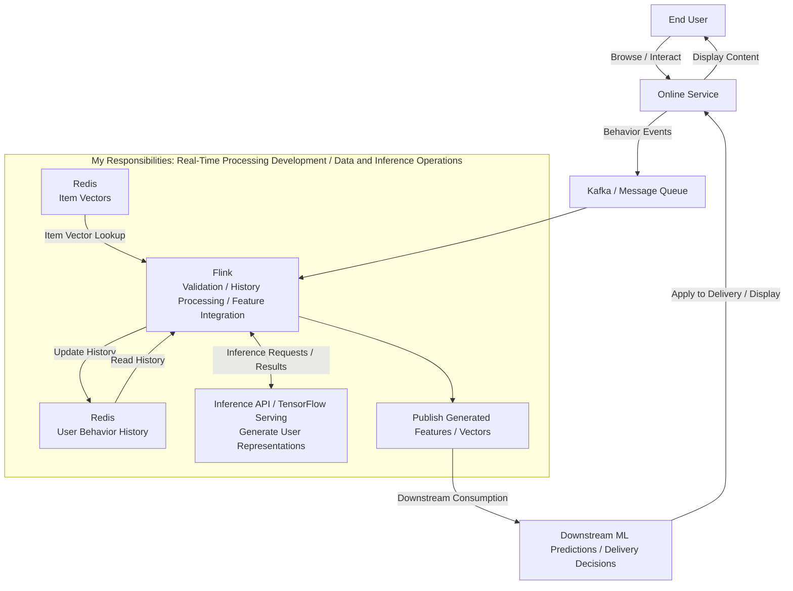
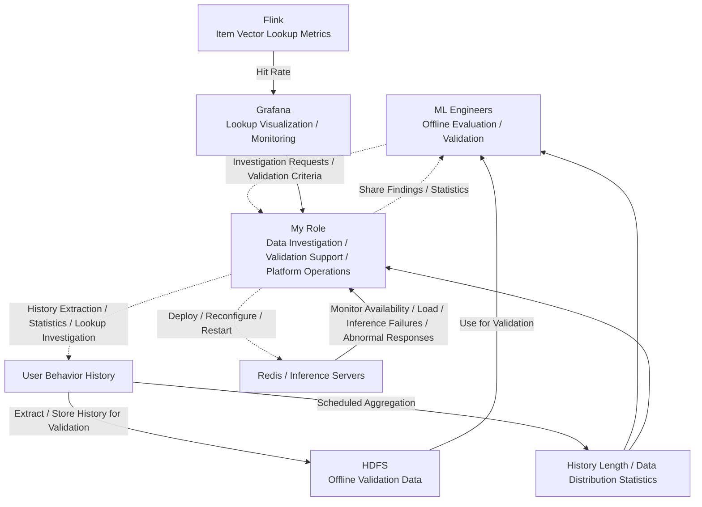

# 实时数据平台 — 职业项目作品集

[English](README.md) | [日本語](README.ja.md) | [简体中文](README.zh-CN.md)

所有语言版本的图表均使用英文标签。

我参与大型互联网服务的实时数据平台开发与运维，将用户行为数据用于机器学习预测及内容分发决策。工作范围包括基于 Java / Apache Flink 的流处理、基于 Python / Apache Airflow 的数据流水线、支持 ML 人员离线验证的数据调查，以及 Redis 和推理服务器运维。

> 本资料用于公开展示。为遵守保密义务，文中对业务内容进行了概括，不披露公司名称、服务名称、内部系统名称、数据定义、配置值、性能指标及故障详情。

## 工作概况

| 项目 | 内容 |
|---|---|
| 参与时间 | 2025 年 1 月至今 |
| 职位 | 数据工程师 / 后端工程师 |
| 负责阶段 | 设计、实现、单元测试、预发布环境验证、发布、运维改进、故障调查 |
| 主要领域 | 实时流处理、特征与推理集成、ML 验证数据调查、数据质量监控、Redis 与推理服务器运维 |

## 项目一：实时数据采集与增强平台

负责平台的开发与运维，实时处理来自多个服务的用户行为数据，并转换为后续分析与推荐处理可用的格式。

- 使用 Apache Flink 实现事件解码、校验、过滤、转换、主数据补充与输出处理。
- 适配搜索、电商等多个领域的事件 Schema 变更、新属性、缺失值处理及敏感类别排除。
- 改进 Redis 参考数据读取、键设计、TTL 管理、重连与异步访问。
- 新增 Apache Airflow 主数据集成 DAG，设计重试与传感器，处理数据源迁移及平台升级。
- 建立基于 Spark / SQL / Iceberg 的数据转换与验证流程。
- 维护 Kubernetes 清单、环境配置、Secret 引用、消息主题与 CI/CD 工作流。
- 使用 Python / MCP 构建只读验证工具，提高跨查询引擎、Redis、消息队列的检查效率。
- 新增使用 Mock 的单元测试，覆盖 Schema 边界、null、空数组及异常值。

## 项目二：支持个性化的实时特征与推理集成平台

自 PoC 阶段起持续开发数据流水线，整合用户行为历史与物品特征，通过在线推理 API 生成并提供表示用户兴趣的向量。生成的特征与向量供下游预测模型使用，使线上服务的分发与展示决策能够反映用户近期行为。

除实时处理开发外，还根据 ML 人员的调查请求提供验证数据、定期汇总历史数据统计、监控特征查询，并负责 Redis 和推理服务器运维。

### 实时处理与推理集成

- 使用 Flink 解码 Kafka / 消息队列事件，实现 event time、watermark、去重、历史合并与窗口聚合。
- 将历史采集、预处理、特征查询、推理请求与结果分发设计为独立处理阶段并实现。
- 将 Redis 历史与特征读取从同步迁移到异步，改进连接共享、重连、拓扑刷新与批量读取。
- 实现在线推理 API 的异步 HTTP / gRPC 客户端、认证刷新、重试、超时与 gzip 压缩。
- 通过批处理、分区分散、数据倾斜处理、减少对象创建及 I/O 并行化，提高效率与稳定性。
- 通过单元测试验证迟到事件、缺失 ID、同时间戳事件、历史上限及服务级过滤等边界条件。
- 建立个人标识符脱敏、日志采样与限速、指标及按环境输出控制。
- 适配 Flink 大版本升级、代码格式与静态检查，并集中管理环境配置。

### 与 ML 人员协作验证和调查

- 根据 ML 人员离线验证所需的检查视角，调查实时行为历史与物品向量查询情况。
- 将目标用户行为历史提取并保存至 HDFS，作为 ML 人员的离线验证数据。
- 定期汇总用户行为历史长度与数据分布，帮助掌握数据特征及变化。
- 共享调查结果与统计信息，持续衔接 ML 验证和实时数据检查。

### 数据质量监控与平台运维

- 在 Flink 应用中实现物品向量查询命中率指标，并接入 Grafana 进行可视化与监控。
- 将命中率作为查询是否成功的指标，分别评估向量内容有效性与模型预测质量。
- 负责用户行为历史 Redis、物品向量 Redis 与 TensorFlow Serving 推理服务器的部署、配置变更、重启及监控。
- 监控平台负载、推理失败与异常响应，跨数据查询、推理 API 和运行基础设施进行调查。

## 代表性架构

以下图示对实际职责与系统协作进行了适合公开展示的抽象，省略内部系统名称、具体连接配置、数据定义、模型规格与运行参数。

### 在线：从用户行为到预测与分发决策

持续将用户操作产生的行为数据更新至特征，供下游预测系统使用。图中按职责展示行为触发的异步特征更新，以及服务侧对已生成特征的使用。

我的职责包括调用推理 API 与运维推理服务器。下游预测模型决策与服务展示作为数据的使用方展示。

### 离线：ML 验证、数据调查与监控协作

在 ML 人员进行离线验证的同时，负责受托数据调查、验证用历史数据提供、定期统计及基于指标的查询状态检查。实线表示数据与监控信息，虚线表示调查请求、结果共享与运维操作。

### 职责与检查目的

| 领域 | 我的职责 | 使用与检查目的 |
|---|---|---|
| 实时数据供给 | 行为历史处理、物品特征查询、推理集成、生成结果分发 | 将近期行为反映到下游预测与分发决策 |
| ML 验证支持 | 响应调查请求、向 HDFS 提供验证用历史、定期统计历史长度与分布 | 帮助 ML 人员理解输入数据实际情况并用于离线验证 |
| 向量查询监控 | 实现 Flink 指标，通过 Grafana 监控命中率 | 检查所需物品向量是否可以读取 |
| 数据与推理平台运维 | Redis、TensorFlow Serving 的部署、配置、重启与监控 | 持续提供数据查询与推理能力，掌握负载、失败与异常响应 |

## 技术栈

| 类别 | 技术 |
|---|---|
| 语言 | Java, Python, SQL, Shell |
| 流处理 | Apache Flink, Kafka, event time / watermark, 异步 I/O, 批量聚合 |
| 数据 / 工作流 | Redis, HDFS, Apache Airflow, Apache Spark, Trino, Apache Iceberg |
| ML 集成 / 推理平台 | TensorFlow Serving, 在线推理 API, 离线验证数据提供 |
| 通信 / 数据格式 | HTTP, gRPC, Protocol Buffers, Avro, JSON, gzip |
| 基础设施 / 交付 | Kubernetes, Docker, Maven, CI/CD, 环境配置管理 |
| 开发 / 验证工具 | MCP, Jupyter Notebook, 只读运维诊断工具 |
| 质量 / 运维 | JUnit, Mockito, 静态检查, Grafana, Flink 指标, 结构化日志, 日志脱敏 |

## 工程实践重点

- **面向运维的实现**：除正常流程外，也考虑延迟、缺失、重连、重试、背压及对检查点的影响。
- **可验证性**：提供指标与安全日志，使预发布环境能够检查配置差异与数据流。
- **数据保护**：避免记录原始标识符和输入数据，仅使用必要信息开展调查。
- **渐进改进**：保持与现有处理兼容，逐步引入异步、批处理、负载分散及测试扩充。

## 资料编写原则

本作品集基于本人实际提交的 Git 变更，以及本人负责的数据调查、验证支持与运维工作编写。由于缺少可供对外公开的证明材料，未列出量化成果。公开仓库不包含业务代码、配置值、日志、数据或内部文档。
